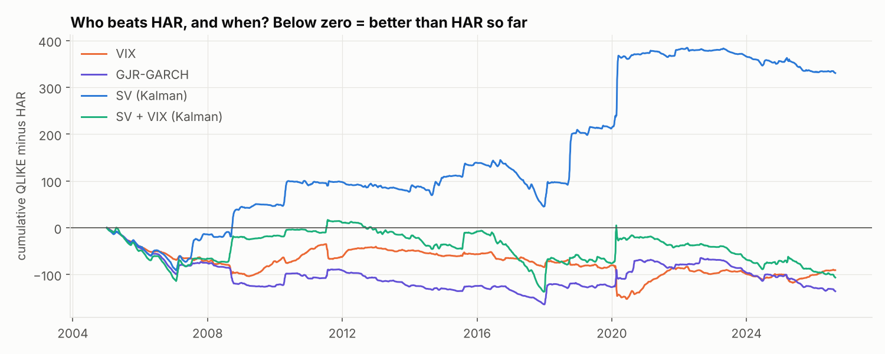
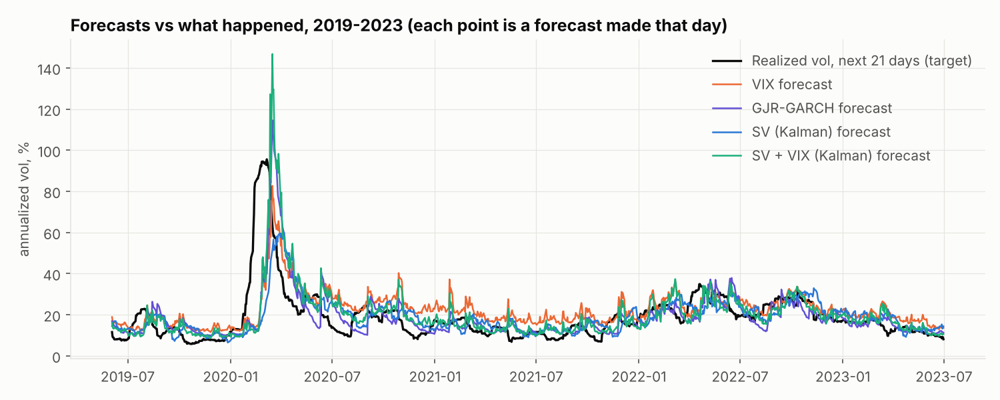
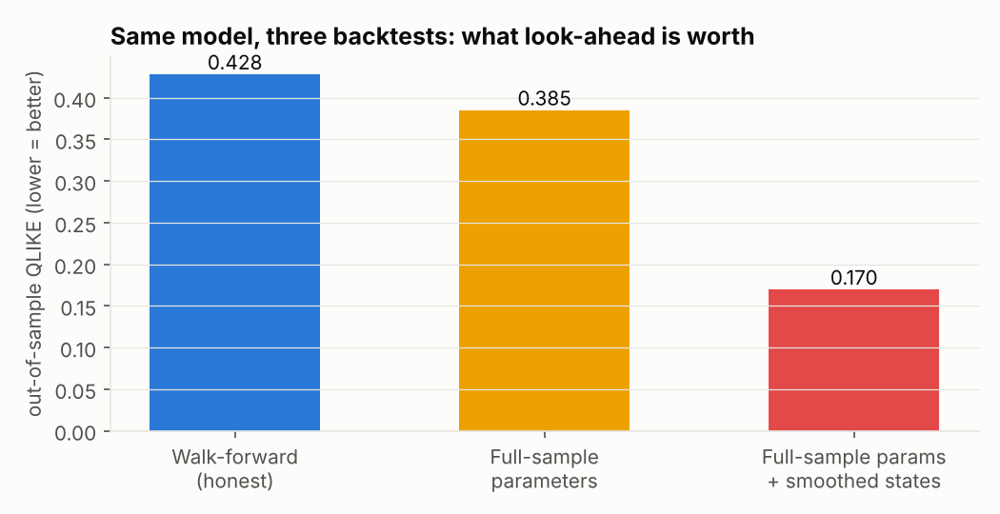
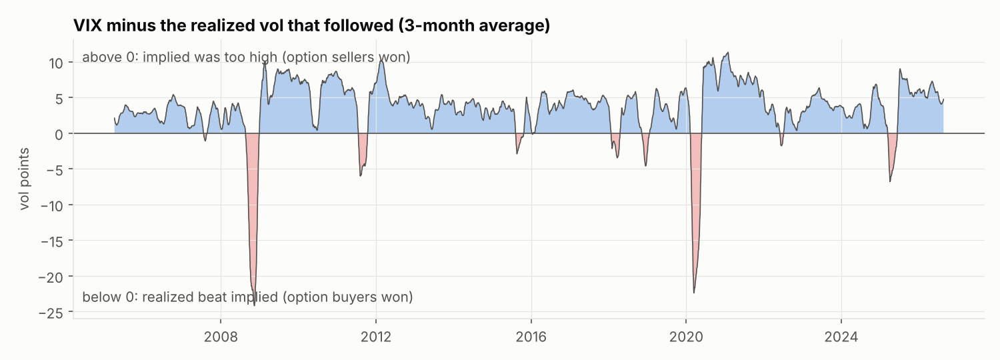
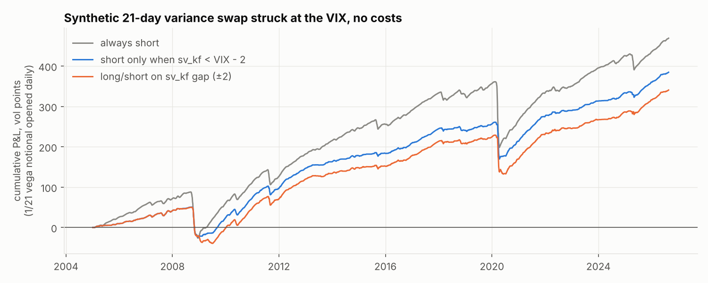

# Forecasting S&P 500 Realized Volatility with State-Space Models

**Question.** Can a stochastic-volatility model, estimated with a Kalman filter, forecast next month's S&P 500 realized volatility better than GARCH, HAR, and the VIX itself?

**Short answer.** Not on its own. Over 21 years of honest walk-forward forecasts (2005–2026, 5,443 forecasts, 260 refits), the plain SV + Kalman model beat only the naive benchmark. The reason is measurable: one day's return says very little about volatility, so the filter's gain is about 0.065 and it reacts too slowly to shocks like October 2008 or March 2020. Giving the same filter a second measurement of the hidden state, the VIX, cut its forecast loss by 19% and produced the lowest mean absolute error of any model, statistically tied with the best (GJR-GARCH and HAR + VIX).

Two side results turned out to be as useful as the main one:
- **Look-ahead is worth a fake 60%.** The identical model scores a QLIKE loss of 0.428 when evaluated honestly and 0.170 if it is allowed to use full-sample smoothed states.
- **A unit test caught a 3× parameter bias.** The textbook small offset in `log(r² + κ)` made the model understate how much volatility moves by a factor of three on simulated data. Real-data results changed materially once it was removed.

The research reflection is in [`docs/research_reflection.md`](docs/research_reflection.md).

---

## Results

### Out-of-sample accuracy, 2005-01-03 to 2026-08-21

Each forecast is made at the close of day *t* for annualized realized volatility over days *t+1 … t+21*.

| Model | RMSE (vol pts) | MAE | QLIKE | Bias | DM vs HAR (QLIKE) | p |
|---|---:|---:|---:|---:|---:|---:|
| HAR + VIX | 7.89 | 4.75 | **0.343** | +1.07 | −1.46 | 0.14 |
| GJR-GARCH | **7.82** | 4.81 | **0.343** | +1.02 | −1.76 | 0.08 |
| **SV + VIX (Kalman)** | 8.13 | **4.57** | 0.348 | +0.47 | −0.86 | 0.39 |
| GARCH(1,1) | 8.09 | 5.03 | 0.350 | +1.23 | −1.72 | 0.09 |
| VIX | 8.37 | 5.97 | 0.351 | +3.46 | −1.12 | 0.27 |
| HAR | 8.29 | 5.55 | 0.368 | +2.09 | — | — |
| **SV (Kalman)** | 8.59 | 5.03 | 0.428 | −0.15 | +1.79 | 0.07 |
| Past 21d RV | 8.97 | 5.31 | 0.532 | 0.00 | +3.66 | 0.00 |

Negative DM statistic = lower loss than HAR. Newey–West variance with 20 lags because daily 21-day forecasts overlap. Full tables, including Mincer–Zarnowitz regressions and DM tests against the VIX, are in [`results/tables/`](results/tables/).

Head-to-head for the SV + VIX model (DM tests, two-sided p-values):

| SV + VIX vs | QLIKE | MSE | MAE |
|---|---|---|---|
| SV (Kalman) | better, p = 0.005 | tie, p = 0.24 | better, p = 0.001 |
| GJR-GARCH | tie, p = 0.77 | tie, p = 0.27 | better, p = 0.04 |
| HAR + VIX | tie, p = 0.61 | tie, p = 0.42 | better, p = 0.06 |
| VIX | tie, p = 0.92 | tie, p = 0.52 | better, p < 0.001 |

All pairwise tests are in `results/tables/dm_pairwise_*.csv`.



The pure SV model's entire deficit comes from forecasts made just before calm turned into crisis: the eight worst months (Feb–Mar 2020, Jan and Oct 2018, Apr 2010, Feb and Jul 2007, Sep 2008) add up to more than 100% of its total excess loss over HAR. Outside those months it is slightly *better* than HAR, and it has been gaining ground since 2023.

### Loss by period (QLIKE, lower is better)

| Period | VIX | GARCH | GJR | HAR | HAR+VIX | SV | SV+VIX |
|---|---:|---:|---:|---:|---:|---:|---:|
| 2005–07 pre-crisis | 0.196 | 0.177 | 0.171 | 0.300 | **0.135** | 0.197 | 0.174 |
| 2007–09 GFC | 0.293 | 0.335 | **0.269** | 0.356 | 0.411 | 0.584 | 0.468 |
| 2009–19 post-GFC | 0.340 | 0.333 | 0.333 | 0.333 | **0.302** | 0.395 | 0.313 |
| 2020 COVID | **1.450** | 1.740 | 1.829 | 1.612 | 1.871 | 2.243 | 1.832 |
| 2021–26 recent | 0.264 | 0.216 | 0.198 | 0.243 | 0.213 | 0.213 | **0.182** |

No model wins every regime. The VIX is the best forecaster in the COVID year, when markets were pricing information that no backward-looking model had. SV + VIX is the best model in the most recent five years.



### The look-ahead experiment



Same SV model, three ways of backtesting it:

| Version | QLIKE | Mincer–Zarnowitz R² |
|---|---:|---:|
| Walk-forward: parameters and states use data up to *t* | 0.428 | 0.39 |
| Parameters estimated on the full sample, states filtered | 0.385 | 0.43 |
| Full-sample parameters + RTS-smoothed states | 0.170 | 0.71 |

Smoothed states look like a breakthrough. They are the result of letting the model see the future. This is the same class of mistake as comparing forecasts against full-sample smoothed components, which I once had to debug in a production car-sales forecasting model. `tests/test_no_lookahead.py` now checks every model for it directly: corrupt all data after a cutoff date and require forecasts up to that date to stay identical to within 1e-10.

### What the VIX says, and the trade it implies



The VIX exceeded subsequent 21-day realized volatility on 83.6% of days, by 3.46 vol points on average. That is the variance risk premium. It reverses violently in crises.

The signal test uses a **synthetic 21-day variance swap struck at the VIX**: short-vol P&L per unit of vega notional is (VIX² − RV²) / (2·VIX). There is no free history of S&P 500 option prices, so this is a stylized trade, not a tradeable backtest (details below).



| Rule (no costs) | Months active | Mean P&L / month | Hit rate | Sharpe | Max drawdown | Worst trade |
|---|---:|---:|---:|---:|---:|---:|
| Always short | 100% | 1.83 | 83.6% | 0.55 | −166 | −252 |
| Short when SV < VIX − 2 | 66% | 1.50 | 83.8% | 0.74 | −115 | −238 |
| Short when SV+VIX < VIX − 2 | 83% | 1.58 | 83.9% | 0.63 | −150 | −252 |
| *Short when GJR < VIX − 2* | 55% | 1.71 | 85.7% | 1.21 | −77 | −251 |

The pre-specified rule (signal = SV model, θ = 2) improves the Sharpe ratio from 0.55 to 0.74 and cuts the drawdown by about a third, but earns less in total and does **not** avoid the crash months; every rule still takes close to the full COVID loss because no forecast saw it coming. The GJR row looks best, but it was not the pre-registered signal and I chose to report it only for comparison. With 0.5 vol points of cost per trade the SV rule's Sharpe falls to 0.60 and always-short to 0.40 ([`results/tables/backtest.csv`](results/tables/backtest.csv)).

---

## Method

### Data

| Series | Source | Coverage |
|---|---|---|
| S&P 500 close, 1999–2018 | bundled with the [`arch`](https://github.com/bashtage/arch) package | 1999-01-04 → 2018-12-31 |
| S&P 500 close, last 10 years | [FRED: SP500](https://fred.stlouisfed.org/series/SP500) | 2016-10-10 → 2026-10-09 |
| VIX close | Cboe, mirrored at [datasets/finance-vix](https://github.com/datasets/finance-vix) | 1990 → 2026-09-22 |

The two S&P sources overlap for 560 days and agree to within 0.04 index points; `build_data.py` asserts this. Raw index files are not committed (S&P and Cboe license their data); `make data` downloads them. Returns are computed on the S&P trading calendar before joining the VIX, so a holiday print in the VIX file can never create a two-day return.

### Target and units

r_t = 100 · ln(P_t / P_{t−1}). The target at origin *t* is RV = √(252/21 · Σ_{k=1..21} r²_{t+k}), annualized percent. The VIX (30 calendar days ≈ 21 trading days) is used directly as a forecast in the same units.

### Models

| Model | Specification |
|---|---|
| Past 21d RV | random walk on realized vol |
| VIX | VIX close at *t* |
| GARCH(1,1), GJR-GARCH | Gaussian QML via `arch`; 21-step variance forecasts summed |
| HAR, HAR + VIX | direct 21-day regression of average future r² on daily, weekly, monthly average r² (+ VIX²/252) |
| **SV (Kalman)** | log-variance AR(1); observation log r²ₜ + 1.27 = hₜ + ξₜ with Var ξ = π²/2 fixed; QML via `statsmodels` `UnobservedComponents` |
| **SV + VIX (Kalman)** | adds log(VIX²/252) = d + b·(hₜ − μ) + uₜ, where uₜ is a persistent AR(1) premium state; custom `MLEModel` |

SV forecasts use the filtered state mean and covariance: with m_k and v_k the mean and variance of h_{t+k}, E[r²_{t+k}] = exp(m_k + v_k/2), summed over k = 1…21.

### Evaluation protocol

- First forecast 2005-01-03 (six years of training data); expanding window.
- Parameters re-estimated every 21 trading days using data up to the refit date only; HAR training rows must have their whole 21-day target observed by then.
- Between refits, parameters are frozen and models are filtered forward daily.
- Losses: RMSE on vol, QLIKE on variance (Patton 2011, robust to the noise in RV as a proxy). Diebold–Mariano tests with Newey–West(20).

### Known limitations

- RV is built from daily closes, a noisy proxy. Intraday 5-minute RV would make every model look better and sharpen the comparisons.
- The SV + VIX model was added *after* seeing the pure SV result, so its out-of-sample period is not fully pristine as a test of that idea. The code for it is unchanged from the first run.
- The trade is synthetic: VIX ≠ exact variance-swap strike, 30 calendar days ≠ 21 trading days, no bid-ask, margin or path-dependent hedging error. Positions overlap; Sharpe and drawdown use non-overlapping monthly samples averaged over all 21 start offsets.
- QML-SV is the simplest way to estimate SV. Particle filters or MCMC use the exact log-χ² likelihood and should react faster.

---

## Reproduce

```bash
pip install -r requirements.txt
make data      # download S&P 500 (FRED + arch) and VIX
make test      # look-ahead and parameter-recovery tests (~30 s)
make results   # full walk-forward study (~20 min; SV+VIX refits dominate)
```

```
src/volforecast/
  data.py          splice, returns, forward RV target
  sv_kalman.py     SV state-space model, QML fit, filter/smoother, forecasts; SV+VIX model
  models.py        walk-forward runners for all models, look-ahead variants
  evaluation.py    QLIKE, RMSE, Diebold-Mariano (Newey-West), Mincer-Zarnowitz, periods
  backtest.py      synthetic variance-swap signal test
  plots.py         figures
scripts/           build_data.py, run_all.py
tests/             test_no_lookahead.py
results/           forecasts.csv, tables/, figures/, summary.json
docs/              research_reflection.md
```

## References

- Harvey, A., Ruiz, E. & Shephard, N. (1994). Multivariate stochastic variance models. *Review of Economic Studies*.
- Corsi, F. (2009). A simple approximate long-memory model of realized volatility. *Journal of Financial Econometrics*.
- Glosten, L., Jagannathan, R. & Runkle, D. (1993). On the relation between the expected value and the volatility of the nominal excess return on stocks. *Journal of Finance*.
- Patton, A. (2011). Volatility forecast comparison using imperfect volatility proxies. *Journal of Econometrics*.
- Carr, P. & Wu, L. (2009). Variance risk premiums. *Review of Financial Studies*.
- Diebold, F. & Mariano, R. (1995). Comparing predictive accuracy. *Journal of Business & Economic Statistics*.

*Kaiki Ikeda · October 2026 · MIT License (code). Data belongs to its providers.*
